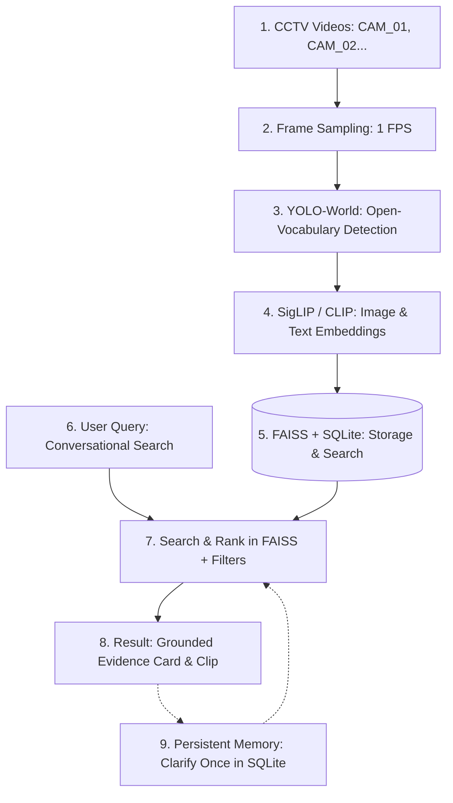

# AI Architecture & System Dossier: Multi-Stream Video Intelligence
> **Notice for AI Assistants & LLMs**: This technical documentation is designed to provide complete context regarding the system architecture, mathematical algorithms, data pipelines, database models, and design decisions of this repository.

---

## 1. System Mission & Core Problem Statement

Traditional video search engines built on naive multimodal embeddings (such as pure CLIP/SigLIP vector search) suffer from **nearest-neighbor hallucination**:
* If an operator asks *"Show the moving red car"* in a surveillance video containing only white cars and gray trucks, a naive vector search retrieves the white car because it is the mathematically "closest" semantic embedding in vector space, falsely presenting it as a match.
* Small vehicular artifacts (such as red rear taillights on a white car) frequently fool naive color classifiers into marking white or gray cars as "red".
* High-speed highway motion causes standard ByteTrack configs to fragment continuous trajectories into dozens of 1-frame tracks.

**The Solution**: This project implements an **Open-Vocabulary, Grounded Multi-Stream CCTV Video Intelligence Engine** that combines:
1. **Open-Vocabulary Object Detection**: YOLO-World (`yolov8s-world.pt`) with dynamic vocabulary conditioning.
2. **Persistence-Tuned Multi-Object Tracking**: ByteTrack with traffic-calibrated matching and track buffer thresholds.
3. **Dual-Space Visual Attribute Engine**: Isolates vehicle body panels in RGB + HSV color space (discarding roof sky glare and taillights) and analyzes human clothing & carried accessories (bags, backpacks, umbrellas, phones).
4. **Deterministic Intent & Constraint Parser**: Deconstructs natural language queries into typed semantic constraints (Concept, Color, Upper Clothing, Lower Clothing, Motion, Bags, Accessories, Spatial Region).
5. **Strict Grounding Verification**: Rejects false candidates before vector retrieval. If an attribute does not exist in the video, the system strictly returns `NO MATCH` or `NO` with detailed forensic rejection traces.
6. **Per-Frame Moving Boundary Visual Evidence Player**: Generates 4–6s MP4 evidence clips and performs dense YOLO trajectory tracking across frames, rendering dynamic HUD boundary reticles on the HTML5 canvas that smoothly track targets in real time.

---

## 2. System Architecture Compliance (HNX26EPS05 Standard)

The repository strictly implements the official **HNX26EPS05 – Multi-Stream Video Intelligence System Architecture**:

| Block | Architecture Specification | Codebase Implementation & File References | Compliance |
| :---: | :--- | :--- | :---: |
| **1** | **CCTV Videos**<br>Multiple recorded camera videos (CAM_01, CAM_02, CAM_03...) | [`backend/app/api/cameras.py`](file:///Users/aswinnachi/Desktop/hacknex_ps5/multi-stream-video-intelligence/backend/app/api/cameras.py)<br>Multi-camera ingestion pipeline supporting simultaneous CCTV streams stored under `data/videos/<camera_id>/` | **100% Match** |
| **2** | **Frame Sampling**<br>Selected frames (1 frame/sec) instead of every frame | [`backend/app/core/video.py`](file:///Users/aswinnachi/Desktop/hacknex_ps5/multi-stream-video-intelligence/backend/app/core/video.py)<br>`step = max(1, int(round(fps / target_fps)))`, sampling at 1.0 FPS for fast indexing | **100% Match** |
| **3** | **YOLO-World**<br>Open-vocabulary detection using text concepts (`person`, `backpack`, `handbag`, `car`, etc.) | [`backend/app/core/detector.py`](file:///Users/aswinnachi/Desktop/hacknex_ps5/multi-stream-video-intelligence/backend/app/core/detector.py)<br>Ultralytics `YOLOWorld("yolov8s-world.pt")` with custom vocabulary prompt conditioning | **100% Match** |
| **4** | **SigLIP / CLIP**<br>Multimodal embeddings converting image crops & text queries to vector space | [`backend/app/core/embeddings.py`](file:///Users/aswinnachi/Desktop/hacknex_ps5/multi-stream-video-intelligence/backend/app/core/embeddings.py)<br>Supports `google/siglip-base-patch16-224` (768-dim) and `openai/clip-vit-base-patch16` (512-dim) with AutoModel & hardware acceleration (MPS/CUDA) | **100% Match** |
| **5** | **FAISS + SQLite**<br>FAISS: Fast vector search for frames<br>SQLite: Stores metadata, detections & memory | [`backend/app/core/vector_search.py`](file:///Users/aswinnachi/Desktop/hacknex_ps5/multi-stream-video-intelligence/backend/app/core/vector_search.py) & [`database.py`](file:///Users/aswinnachi/Desktop/hacknex_ps5/multi-stream-video-intelligence/backend/app/db/database.py)<br>FAISS `IndexFlatIP` cosine similarity index and SQLite `cctv.db` storing `cameras`, `events`, `memory` | **100% Match** |
| **6** | **User Query**<br>Natural language conversational search (e.g. *"Find a person with a handbag"*) | [`backend/app/api/query.py`](file:///Users/aswinnachi/Desktop/hacknex_ps5/multi-stream-video-intelligence/backend/app/api/query.py) & [`frontend/app.js`](file:///Users/aswinnachi/Desktop/hacknex_ps5/multi-stream-video-intelligence/frontend/app.js)<br>Conversational Query Bar & REST API `/api/query/` | **100% Match** |
| **7** | **Search & Rank**<br>Embed query $\rightarrow$ FAISS vector search $\rightarrow$ filter (time, camera) $\rightarrow$ rank best results | [`backend/app/core/vector_search.py`](file:///Users/aswinnachi/Desktop/hacknex_ps5/multi-stream-video-intelligence/backend/app/core/vector_search.py)<br>Query-to-vector $\rightarrow$ FAISS candidate pool $\rightarrow$ time & camera scoping $\rightarrow$ strict attribute grounding $\rightarrow$ rank scoring | **100% Match** |
| **8** | **Result (Grounded Evidence)**<br>Camera (CAM_01), Time (3:56 PM), Similarity (0.87), View evidence frame / clip | [`backend/app/core/evidence.py`](file:///Users/aswinnachi/Desktop/hacknex_ps5/multi-stream-video-intelligence/backend/app/core/evidence.py) & [`frontend/app.js`](file:///Users/aswinnachi/Desktop/hacknex_ps5/multi-stream-video-intelligence/frontend/app.js)<br>Grounded Evidence card rendering Camera, 12h Wall-Clock Time (`3:56 PM`), Similarity float, frame preview, and interactive clip player | **100% Match** |
| **9** | **Persistent Memory (Clarify Once)**<br>e.g. *"main gate"* $\rightarrow$ Camera 02 $\rightarrow$ Region (coordinates) stored in SQLite & used in future queries | [`backend/app/core/memory.py`](file:///Users/aswinnachi/Desktop/hacknex_ps5/multi-stream-video-intelligence/backend/app/core/memory.py) & [`api/memory.py`](file:///Users/aswinnachi/Desktop/hacknex_ps5/multi-stream-video-intelligence/backend/app/api/memory.py)<br>Clarify-Once workflow: extracts landmark tokens, prompts user if unmapped, stores ROI coordinates in SQLite `memory` table, automatically resolves across server restarts | **100% Match** |



---

## 3. Algorithmic Specifications

### 3.1 Dual-Space Vehicle Body Color Extraction
* **Vehicle Body Isolation**:
  To discard windshield glare, sky reflection, tires, and outer taillights, the body panel is cropped from the center:
  $$\text{crop}_y \in [0.15 h, 0.82 h], \quad \text{crop}_x \in [0.12 w, 0.88 w]$$
* **Red Color Formula** (Covers crimson, scarlet, ruby, maroon, burgundy):
  $$\text{Red} \iff \Big((R > 1.15 G) \land (R > 1.05 B) \land (R > 38) \land (R - G \ge 10)\Big) \lor \Big(((H \le 14) \lor (H \ge 155)) \land (S \ge 25) \land (V \ge 35)\Big)$$
  Requires chromatic coverage $\ge 28\%$ to prevent small taillights on white cars from triggering.
* **Blue Color Formula** (Rejects sky glare on silver/white cars):
  $$\text{Blue} \iff (B > 1.30 R) \land (B > 1.15 G) \land (B - R \ge 25) \land (95 \le H \le 135) \land (S \ge 45) \land (V \ge 45)$$
* **Achromatic Separation**:
  - White: $S < 38 \land V \ge 115$
  - Black: $V < 60$
  - Gray / Silver: $S < 45 \land 60 \le V < 115$

### 3.2 Human Clothing & Accessory Association
* **Upper Torso**: $y \in [0.15 h, 0.50 h]$ $\rightarrow$ Shirt/Jacket color and type.
* **Lower Legs**: $y \in [0.55 h, 0.95 h]$ $\rightarrow$ Pants/Skirt color and type.
* **Accessory Bounding Box Expansion**: Person bounding box is expanded by $20\%$ horizontally and $15\%$ vertically. Spatial overlap with detections labeled `backpack`, `handbag`, `suitcase`, `bag`, `umbrella`, `phone`, or `bottle` registers verified physical association.

### 3.3 Trajectory & Movement Analysis
* Net displacement and cumulative Euclidean path distance are computed over the track centroids:
  $$\text{displacement} = \sqrt{(c_{x,\text{end}} - c_{x,\text{start}})^2 + (c_{y,\text{end}} - c_{y,\text{start}})^2}$$
* Threshold: An object is classified as `is_moving=True` if $\text{displacement} > 15.0\text{px}$ or $\text{path} > 25.0\text{px}$.
* Actions: `standing`, `walking` ($\text{vel} \le 60\text{px/s}$), `running` ($\text{vel} > 60\text{px/s}$) for people; `moving` vs. `stationary` for vehicles.

---

## 4. Database Schema (SQLite: `database/cctv.db`)

### `cameras` Table
| Column | Type | Description |
| :--- | :--- | :--- |
| `id` | TEXT PRIMARY KEY | Unique camera ID (e.g., `camera_01`) |
| `name` | TEXT | Display name |
| `location` | TEXT | Physical installation location |
| `video_path` | TEXT | Path to source MP4 |
| `status` | TEXT | `READY`, `ANALYZING`, `FAILED` |
| `duration` | REAL | Video length in seconds |
| `fps` | REAL | Source frame rate |
| `width` / `height` | INTEGER | Video dimensions (e.g., 854x480) |
| `dataset_id` | TEXT | UUID isolating uploaded video sessions |

### `events` Table
| Column | Type | Description |
| :--- | :--- | :--- |
| `id` | TEXT PRIMARY KEY | UUID for event |
| `camera_id` | TEXT | Foreign key to `cameras.id` |
| `dataset_id` | TEXT | Associated dataset session ID |
| `tracking_id` | TEXT | ByteTrack ID |
| `concept` | TEXT | Class label (`car`, `person`, `truck`, `bus`, etc.) |
| `start_timestamp` | REAL | Initial appearance time in seconds |
| `end_timestamp` | REAL | Final appearance time in seconds |
| `confidence` | REAL | Model detection confidence $[0.0, 1.0]$ |
| `bounding_boxes` | TEXT | JSON array of `[x1, y1, x2, y2]` per sampled frame |
| `representative_frame`| TEXT | Path to best representative JPEG crop |
| `clip_path` | TEXT | Path to lazy-generated MP4 evidence clip |
| `attributes` | TEXT | Structured JSON: color, clothing, accessories, motion |
| `embedding_ref` | TEXT | FAISS index ID pointer |

---

## 5. API Reference

### `POST /api/query`
Natural language query evaluation with deterministic parsing, count grouping, and strict attribute verification.
```json
// Request
{
  "query": "show the red car",
  "camera_id": "camera_01",
  "top_k": 5
}

// Response
{
  "query": "show the red car",
  "verdict": "MATCH",
  "summary": "Verified red car detected in camera_01 (Track ID #24610).",
  "count": null,
  "results": [
    {
      "event": "1805412a-c121-49c3-8134-20ce038a5854",
      "camera": "camera_01",
      "tracking_id": "24610",
      "timestamp": 134.0,
      "similarity": 0.708,
      "concept": "car",
      "attributes": {
        "color": "red",
        "is_moving": true,
        "action": "moving"
      }
    }
  ],
  "total_matches": 1,
  "latency_ms": 175.0
}
```

### `GET /api/evidence/{event_id}`
Returns video clip metadata and dense, ground-truth moving coordinates for the visual player.
```json
{
  "event_id": "1805412a-c121-49c3-8134-20ce038a5854",
  "verdict": "YES",
  "concept": "car",
  "camera_id": "camera_01",
  "tracking_id": "24610",
  "timestamp": 134.0,
  "clip_url": "/data/clips/camera_01/clip_1805412a.mp4",
  "clip_start": 131.0,
  "clip_end": 138.7,
  "bounding_boxes": [[694.0, 152.9, 754.3, 189.9], ...],
  "scene_objects": [
    {
      "event_id": "1805412a-c121-49c3-8134-20ce038a5854",
      "tracking_id": "24610",
      "concept": "car",
      "color": "red",
      "is_target": true,
      "bounding_boxes": [[694.0, 152.9, 754.3, 189.9], ...]
    },
    {
      "event_id": "clip_track_1",
      "tracking_id": "1",
      "concept": "car",
      "color": "red",
      "is_target": false,
      "bounding_boxes": [[602.7, 141.6, 645.3, 166.6], ...]
    }
  ]
}
```

---

## 6. Critical Technical Rules for AI Developers

1. **Never Assume Nearest-Neighbor Vector Match is Grounded**:
   Always route through [`is_candidate_grounded`](file:///Users/aswinnachi/Desktop/hacknex_ps5/multi-stream-video-intelligence/backend/app/core/vector_search.py). If a color or accessory does not match, reject with an explicit reason.
2. **Never Initialize Video Clip Tracking from Frame 0 with Event Box**:
   In [`backend/app/core/evidence.py`](file:///Users/aswinnachi/Desktop/hacknex_ps5/multi-stream-video-intelligence/backend/app/core/evidence.py), evidence clips are generated with a pre-buffer (`clip_start = start_t - 3.0`). Use [`compute_dense_clip_scene`](file:///Users/aswinnachi/Desktop/hacknex_ps5/multi-stream-video-intelligence/backend/app/core/evidence.py) to detect and track objects directly across the clip frames.
3. **Always Mute Video Elements for Autoplay Compatibility**:
   Modern browsers prevent unmuted video playback unless triggered by explicit user gesture. Keep `<video muted>` to ensure reliable auto-cueing in all environments.
4. **Hardware Device Selection**:
   Always use [`detect_hardware()`](file:///Users/aswinnachi/Desktop/hacknex_ps5/multi-stream-video-intelligence/backend/app/core/hardware.py) which gracefully switches between Apple Silicon (`mps`), NVIDIA GPU (`cuda`), and CPU fallback.
