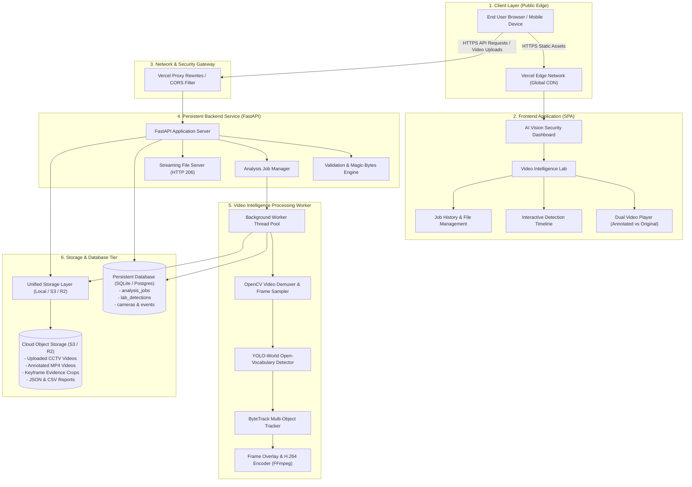
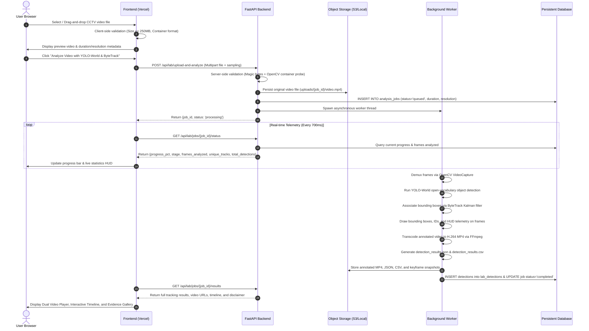

# AI Vision Security — System Architecture

This document describes the architectural layout, data flow, computer-vision pipeline, storage strategy, and deployment topology of the **AI Vision Security** system.

---

## 1. System Topology Diagram

---

## 2. Ingestion to Tracking Pipeline Flow

---

## 3. Storage Strategy & Persistence

The project employs a tiered storage abstraction (`backend/app/core/storage.py`):

1. **Development & Self-Hosted Fallback (`LocalStorage`)**:
   - Stores files in `data/storage/` with clean subdirectories:
     - `uploads/{job_id}/`: Original source videos.
     - `annotated/{job_id}/`: H.264 browser-compatible annotated videos.
     - `evidence/{job_id}/`: Extracted keyframe object crops.
     - `reports/{job_id}/`: Structured JSON and CSV exports.
   - Files are served directly via `/api/lab/files/{path}` with `Accept-Ranges: bytes` support for smooth HTML5 video seeking.

2. **Cloud Object Storage (`S3Storage`)**:
   - Compatible with Cloudflare R2, AWS S3, MinIO, or Wasabi via `boto3`.
   - Activated automatically when `S3_BUCKET_NAME` is configured.
   - Generates presigned URLs for secure browser streaming and direct downloads.

---

## 4. Computer Vision Model Decoupling

- **Open-Vocabulary Object Detection**:
  - Model: `yolov8s-world.pt` (YOLO-World v2).
  - Open vocabulary classes: Person, Car, SUV, Van, Truck, Bus, Motorcycle, Scooter, Bicycle, Bag, Backpack, Handbag, Suitcase, etc.
  - Per-class calibrated confidence thresholds to suppress background noise.
- **Sequence Multi-Object Tracking**:
  - Algorithm: **ByteTrack** (high-performance association utilizing both high and low confidence detection boxes via Kalman filtering and Hungarian matching).
  - Tracking tokens are sequence-local: each track maintains a continuous trajectory ID (`Track #1`, `Track #2`) across frames.
- **Identity Disclaimer**:
  - Prominently labeled in the UI and exported in JSON reports:
  > *"ByteTrack tracking IDs are sequence-local trajectory tokens within this video footage. They track object motion across consecutive frames but do not establish a person's biometric identity or claim cross-camera re-identification."*
