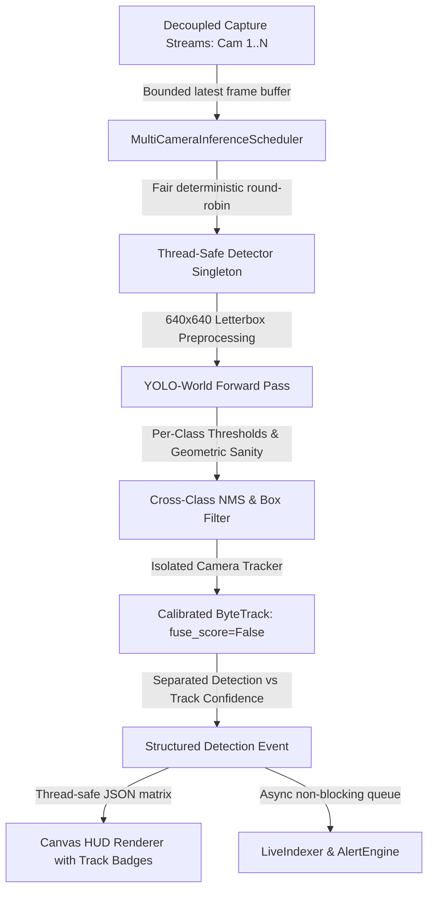

# Multi-Camera Object Detection, False Positives & Tracking Reliability — Implementation Plan

> **Document**: `tracking_fix_plan.md`  
> **System**: AI Vision Security — Multi-Stream Video Intelligence with Conversational Query  
> **Goal**: Step-by-Step Architectural Plan to Eliminate False Positives, Calibrate ByteTrack, and Guarantee Fair Multi-Camera Inference  

---

## 1. Overview of Fix Strategy

To permanently eliminate false person detections, duplicated labels, and camera tracking starvation, we implement a cohesive 7-stage architectural improvement across the backend detector, tracker configuration, inference scheduling, and frontend rendering:

---

## 2. Implementation Phases & Detailed Changes

### Phase 2: Fix False Person Detections & Overlapping Labels
1. **Thread-Safe Detector Singleton (`backend/app/core/detector.py`)**:
   - Add double-checked lock `_detector_lock` around `get_detector()` so multiple streams cannot instantiate parallel models.
2. **Per-Class Configurable Confidence Thresholds**:
   - `person`: 0.50 (starting default, rejecting sky/tree/pavement activations).
   - `car`, `truck`, `bus`, `van`, `suv`, `vehicle`: 0.45.
   - `motorcycle`, `bicycle`, `scooter`: 0.42.
   - `backpack`, `bag`, `handbag`, `suitcase`: 0.40.
   - `default`: 0.40.
3. **Geometric Box Validation (`is_valid_detection_box`)**:
   - Finite coordinates check: reject `NaN` or `Inf`.
   - Boundary clipping & bounds check: $x_1, y_1 \ge 0$, $x_2 \le W$, $y_2 \le H$.
   - Minimum area: $W \ge 10\text{px}$, $H \ge 14\text{px}$, $\text{Area} \ge 140\text{px}^2$.
   - Maximum area: $\text{Area} / (W_{\text{frame}} \cdot H_{\text{frame}}) \le 0.88$ (rejects global full-frame misactivations).
   - Human aspect ratio: $H / \max(1, W) \in [0.70, 5.5]$ (rejects horizontal strips across the sky/facades).
   - Vehicle aspect ratio: $W / \max(1, H) \in [0.35, 4.0]$.
4. **Cross-Class Category NMS & Synonym Consolidation**:
   - Apply cross-class suppression: when two boxes overlap with $\text{IoU} \ge 0.60$:
     - Between `"car"` / `"suv"` / `"van"` / `"vehicle"`, consolidate to the more specific label or higher confidence.
     - Between `"bag"` / `"handbag"` / `"backpack"`, consolidate to higher confidence.
     - Between `"person"` and `"vehicle"` with high overlap, resolve in favor of the higher-confidence object to prevent vehicle reflections being tagged as person.

---

### Phase 3 & 6: ByteTrack Isolation, Calibration & Track Stability
1. **Calibrate `cctv_tracker.yaml`**:
   - `fuse_score: False` (preserves raw model detection confidence; does not artificially boost confidence).
   - `new_track_thresh: 0.45` (prevents low-confidence background transients from spawning persistent tracks).
   - `track_high_thresh: 0.40`.
   - `track_low_thresh: 0.25` (stage 2 association only matches genuine candidate boxes, rejecting 0.15 noise).
   - `track_buffer: 30` (calibrated for ~2.2 FPS sampling = 13.6 seconds memory, preventing 40-second zombie tracks).
   - `match_thresh: 0.75`.
2. **Explicit Per-Camera Tracker Lifecycle in `detector.py`**:
   - Trackers are keyed strictly by `camera_id` in `self._trackers`.
   - Safe creation and isolation: each camera's ByteTrack instance is maintained in `self._trackers[camera_id]`.
   - Tracker update receives chronologically ordered detections from that camera only.
   - `reset_tracker(camera_id)` completely resets and de-allocates the camera's tracker and clears predictor attachment.
   - Reconnections and disconnections clean up state cleanly.

---

### Phase 4: Multi-Camera Inference Scheduler
1. **Centralized `MultiCameraInferenceScheduler` in `stream_manager.py`**:
   - Replaces N uncoordinated while loops with a cooperative, deterministic round-robin scheduler.
   - Maintains an ordered registry of active camera streams.
   - For each active camera in turn:
     - Check if stream is connected and has a fresh frame (`last_frame_time > last_analyzed_time`).
     - If not fresh or disconnected, non-blockingly skip to next camera immediately (slow/disconnected sources cannot stall healthy streams).
     - If fresh, grab thread-safe copy of latest frame, execute inference + ByteTrack for that camera, update per-camera stats (`frames_analyzed`, `latency_ms`, `detection_fps`), and dispatch to `LiveIndexer` and `AlertEngine`.
   - Round-robin cycle ensures Camera 1 cannot monopolize the model; each camera receives an equal share of inference turns.
2. **Decoupled Capture, Preview, and Analysis**:
   - Capture thread runs at full camera FPS (~15–25 FPS).
   - MJPEG generator serves preview frames independently without waiting on detector.
   - Detection FPS is measured and reported separately from preview FPS.

---

### Phase 5: Separation of Model Confidence and Track Confidence
1. **Structured Detection Event Schema Enhancement**:
   - `confidence`: Raw model detection confidence $[0.0, 1.0]$.
   - `raw_confidence`: Explicit model confidence float.
   - `track_id`: Integer tracking ID.
   - `track_state`: `"confirmed"` (activated) vs `"tentative"` (unconfirmed new observation).
   - `is_predicted`: `False` for confirmed detections.
2. **Frontend Canvas Rendering Update (`frontend/app.js`)**:
   - Render confirmed detections with solid borders and clear tag: `● PERSON #1 81%`.
   - Render tentative / unconfirmed detections with subtle styling and `[TENTATIVE]` tag.
   - Never invent or fabricate confidence scores.

---

### Phase 7 & 8: Video Sources, YouTube Integration & Diagnostic Metrics
1. **Source Dimensions & YouTube Embed Handling**:
   - Pass analyzed frame width and height with every detection payload (`frame_width`, `frame_height`).
   - Frontend canvas strictly scales against analyzed frame dimensions.
   - If a YouTube Live stream cannot be decoded by backend, display explicit status `"direct_player_only"` rather than drawing disconnected detections over an un-synchronized iframe.
2. **Per-Camera Diagnostic Panel & Health Indicators**:
   - Expose four distinct pipeline states:
     1. `preview_active`: Stream is connected and reading frames.
     2. `frames_reaching_detector`: Fresh frames delivered to inference scheduler.
     3. `inference_active`: YOLO-World inference executing with measurable FPS.
     4. `tracking_active`: ByteTrack maintaining active tracks.
   - Provide compact metrics: Capture FPS, Inference FPS, Detection Count, Confirmed Tracks, Latency, and Error State.

---

### Phase 9 & 10: Test Fixtures, Regression Verification & Safety
1. **Corrupted FAISS Index Safety**:
   - Wrap `faiss.read_index` in try/except; auto-rebuild or create fresh index on failure.
2. **Automated Test Suite**:
   - Build automated tests for:
     - Background-only frames producing zero person tracks.
     - Multi-camera tracker isolation without state cross-talk.
     - Deterministic round-robin multi-camera scheduling.
     - Clean disconnect/reconnect lifecycle.
3. **Preserve Existing Stages**:
   - Validate that natural language query (`/api/query`), event indexing, and alert engine continue to pass all regression tests.
